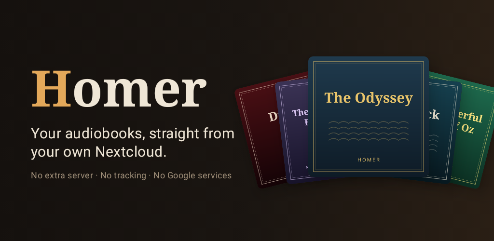
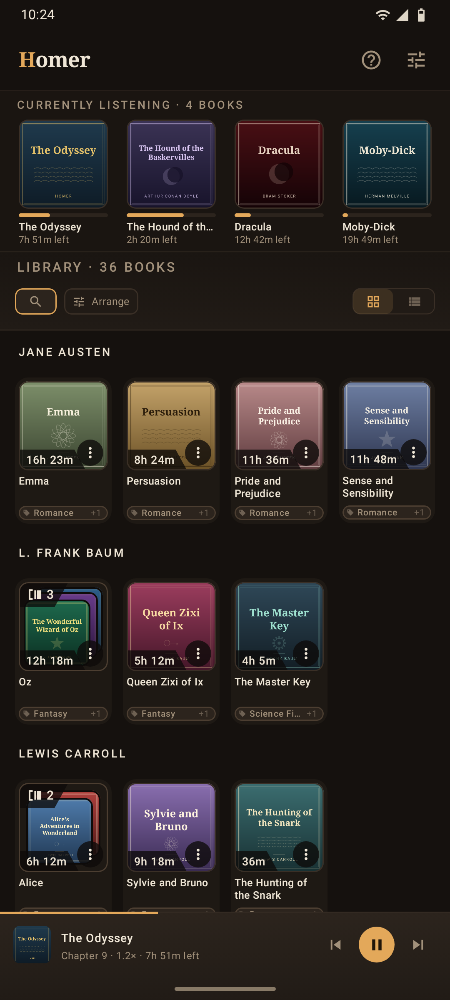
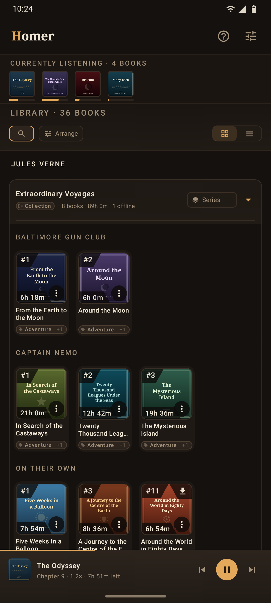
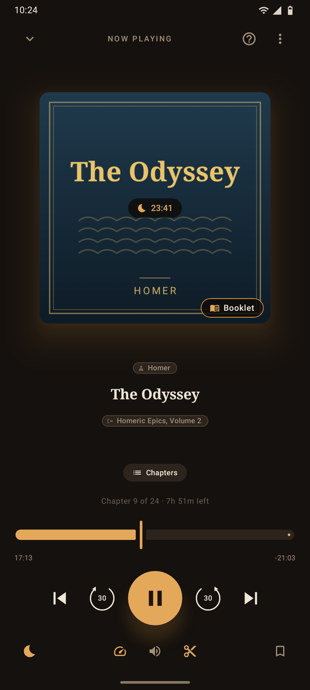
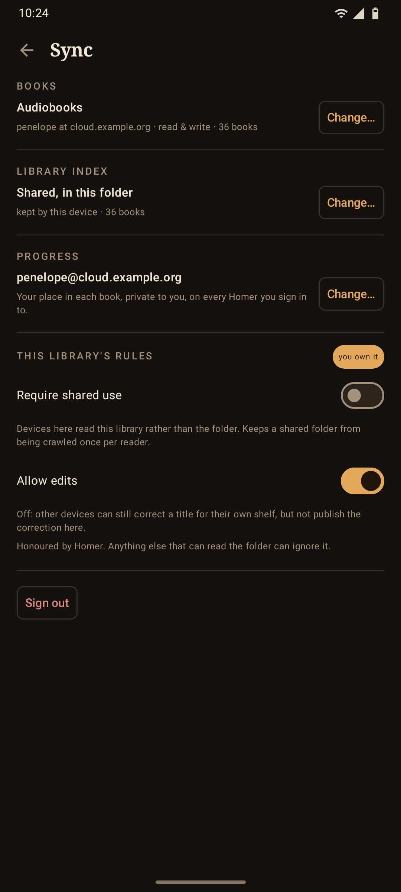

<p align="center">
  
</p>

# Homer

**An audiobook player for the audiobooks you keep in your own Nextcloud.**

Sign in, choose your audiobook folder, and your library is there: streamed straight from your
server, or downloaded for listening offline. There is no extra server to install, no account with
anyone else, no tracking and no Google services. Homer talks to the Nextcloud you point it at, and
to nothing else unless you ask it to.

<p align="center">
  
  
  
  
</p>

Homer runs on Android 8.0 or newer, in English and German.

## Get Homer

- **From GitHub:** download `homer-<version>.apk` from the
  [latest release](https://github.com/geozelot/Homer/releases/latest) and open it on your phone.
  Android asks you once to allow installs from your browser or file manager.
- **With [Obtainium](https://github.com/ImranR98/Obtainium):** add
  `https://github.com/geozelot/Homer`, and it installs new releases as they come out.
- **From F-Droid:** Homer has been submitted and is waiting for review.

All three give you the very same APK, signed with the same key, so you can switch between them later
without reinstalling. F-Droid builds Homer from this source and checks that its build matches the
release here before it ships it.

## Getting started

The first time you open Homer, a short setup asks three things.

1. **Where do your books live?**
   - **My own account:** sign in to your Nextcloud in the browser. Homer gets an app password that
     you can revoke at any time in your Nextcloud's security settings — never your real password.
     The books can be your own files or a folder another user shared with you.
   - **A shared link:** paste a Nextcloud share link (`https://…/s/…`) somebody sent you. No
     account needed; the link can be read-only or let you write.
2. **Which folder?** Your audiobook folder, or nothing to use the whole account. Homer looks at the
   folder and tells you what it found: a Homer library that is already there, ready to use, or the
   offer to create one (see [Sharing a library](#sharing-a-library)).
3. **Where should your place in each book be saved?** In your account, so every phone of yours
   carries on where you left off — or on this phone only.

Every answer can be changed later under *Settings → Sync*.

## Laying out your books

Homer reads the author, series and title of a book from its folders. It understands:

```
Author/Series/Book Title/…audio files
Author/Book Title/…audio files
Book Title/…audio files
```

- A book is any folder with audio files directly inside it. Folders named for a disc — `CD 2`,
  `Teil 3`, or just `02` — count as part of the book above them.
- Files play in number order, so `Chapter 2` comes before `Chapter 10`.
- Folders between the author and the series are skipped, so `Author/Audiobooks/Series/Book` works
  too.
- A book's number in its series comes from the file tags or from a pattern you write. A
  *collection* — Discworld above its Rincewind series, say — is only ever something you set yourself.

**Organised differently?** Describe your layout instead of moving files. *Settings → Upkeep →
Reading folder names* takes patterns like

```
{author}/{title} ({series} {index})
{author}/{**}/{series}/{title}
```

and shows the result on your real books before anything changes. Books no pattern could read are
listed under *Upkeep → Books Homer could not read*. The same page can **ignore folders**, so a folder
of new additions that still need tidying stays out of the library until you are ready.

A single book can be corrected too — title, authors, series, genre — with *Edit book*, without
touching your files.

## What syncs, and where

Homer keeps two things apart.

- **Your listening:** where you are in each book, your bookmarks, and the books you finished or
  hid. If you chose *My account* in setup, these are saved in a small file in your own Nextcloud,
  private to you, so you can carry on from another phone. Otherwise they stay on the phone. They are
  never written into a shared folder. On a share link they stay on the phone, unless you also sign in
  to an account of your own.
- **The library:** titles, authors, series, cover art, lengths, corrections, folder-name patterns
  and ignored folders. Homer can keep these as a *library index* in the library folder itself, so
  your other devices — and anybody else reading the same folder — open the library without scanning
  it again, and a title corrected on one device is corrected on all of them.

### Sharing a library

A family or a group of friends can listen from one audiobook folder, shared in Nextcloud or by link.
The first device creates the library index there; every other device then reads it instead of
working through the whole folder itself. Each person's progress stays in their own account.

The folder's owner can set two rules for everybody else, under *Settings → Sync*:

- **Require shared use:** devices read the library index rather than scanning the folder, so a big
  shared folder is not read once per listener.
- **Allow edits:** whether other devices may publish their corrections. When it is off, anyone can
  still correct a title for their own shelf.

## Features

- **Stream or download** — listen straight from the server, or take books offline; pause, resume or
  cancel downloads, on Wi-Fi only if you like.
- **Playback** — variable speed, skip silence, skip buttons of the length you choose, a little
  rewind when you come back to a book, a volume boost, and a sleep timer with fade-out and shake to
  extend.
- **Chapters** — from books made of many files and from the chapter marks in MP3 and M4B files, with
  a chapter list that shows each chapter's length.
- **Bookmarks**, and controls on the lock screen, in the notification and on Bluetooth headsets.
- **A library to browse** — covers, lengths and time left at a glance. Shelve by author or genre,
  stack series and collections, and sort by title, author (by surname, if you like), length or what
  you played last, with a jump-to-letter lane down the edge. Search suggests authors, series, genres
  and books you have started.
- **Covers** from the files, from an image in the book's folder, or — once you turn it on — from
  Open Library.
- **Booklets** — PDFs filed next to a book, like a booklet, a libretto or a map, open in Homer's own
  reader and go offline with the book.
- **Your own display size**, separate from the phone's, and a layout made for holding the phone
  sideways.

## Updates

Homer can update itself from GitHub, under *Settings → About → Updates from GitHub*. Nothing happens
until you use it:

- **Check now** asks GitHub once, when you tap it.
- **Check automatically** asks once a day. It is **off by default**, because it contacts a third
  party on a schedule you did not ask for. Nothing about you or your library is sent — only the
  question.
- **Release channel:** *Stable*, or *Betas too* if you want to try what is coming. Betas are cut
  often and meant for testing.

When there is a new version, Homer downloads it and hands it to Android's installer, which asks you
to confirm. Obtainium or F-Droid keep Homer up to date just as well, if you prefer.

If several of your devices keep the same shared library, update them together: an older version
may not understand what a newer one wrote there.

## Privacy and security

- Homer talks to your Nextcloud, and otherwise only to **GitHub** when you check for updates and to
  **Open Library** for cover art if you turn that on (*Settings → Upkeep*).
- Signing in uses Nextcloud's Login Flow: Homer holds an app password you can revoke, never your
  real password, and keeps it encrypted with a key in the Android Keystore. Android's backups are
  switched off for Homer, so it does not leave the phone that way either.
- *Settings → Privacy & security* has an **app lock** (fingerprint, face or screen lock) and
  **certificate pinning**: Homer remembers your server's certificate and refuses to connect if it
  ever changes unexpectedly. The full privacy statement is on the same page.

## Permissions

Homer works in its own app storage and needs no storage permission. What it asks for, and why:

- **Network access** (`INTERNET`, `ACCESS_NETWORK_STATE`) — to reach your Nextcloud, and to know
  when you are offline.
- **Playing and downloading in the background** (`FOREGROUND_SERVICE`, `…_MEDIA_PLAYBACK`,
  `…_DATA_SYNC`, `POST_NOTIFICATIONS`, `WAKE_LOCK`) — so a book keeps playing with the screen off and
  downloads keep going after you leave the app, each with a notification.
- **Audio settings** (`MODIFY_AUDIO_SETTINGS`) — for the volume boost.
- **Installing updates** (`REQUEST_INSTALL_PACKAGES`) — used only by the built-in updater. Android
  still makes you allow it for Homer, and asks you to confirm every install. Nothing installs
  silently.
- **All-files access** (`MANAGE_EXTERNAL_STORAGE`) — **optional, and never asked for up front.** Only
  if you choose to keep downloads in a folder of your own with *Settings → Storage → Browse device…*,
  for phones where Android's folder chooser does not work, such as some LineageOS builds. Skip that,
  and it is never granted. This permission is also why Homer is not on Google Play.

## Tips and troubleshooting

- **Playback stops when the screen goes off.** Many phones freeze apps in the background to save
  battery, whatever the app does. *Settings → Playback → Playing in the background* shows whether
  yours does, and opens the system screen to let Homer run.
- **A book shows no length.** Homer measures a book the first time you open it. *Settings → Upkeep
  → Scan* measures every book at once — it reads a little of every file, so on a big library that
  takes a while — and *Try missing lengths* goes back for the files that could not be read.
- **A book has the wrong author or title.** Fix it with *Edit book*, or describe your folder layout
  (see [Laying out your books](#laying-out-your-books)).
- **An update says the release is "signed with a different key".** You are running a copy you built
  yourself. Uninstall it and install the release, or keep building your own.
- **Something else?** *Settings → About → Diagnostics* shows Homer's recent log and lets you share
  it; attach it to an [issue](https://github.com/geozelot/Homer/issues). Your server address and
  account name are masked, but book titles may appear.

## What's new

**2.2.3** brings Homer to F-Droid as the very same APK you get here, and the updater now says
plainly that it fetches updates from GitHub. **2.2** added booklets, several authors per book,
sorting by surname with a jump-to-letter lane, a display size of Homer's own and ignored folders.

Every release is described in [CHANGELOG.md](CHANGELOG.md) and listed on the
[releases page](https://github.com/geozelot/Homer/releases).

## Contributing

Homer is a personal, self-hosted project. A few advanced features — share-link libraries, the
shared library index, chapter text tracks in M4B files, certificate pinning — are best-effort and
still evolving. Issues and patches are welcome. Building, testing and releasing are described in
[docs/DEVELOPMENT.md](docs/DEVELOPMENT.md).

## A note on how this was built

Homer was developed collaboratively with **Claude** (Anthropic) doing the bulk of the
implementation under human direction and review. The commit history reflects that
iterative process.

## License

Homer is free software, licensed under the **GNU General Public License v3.0** — see
[LICENSE](LICENSE). © geozelot. You may use, study, share, and modify it under the terms of the
GPLv3; distributed modifications must remain under the same license.
